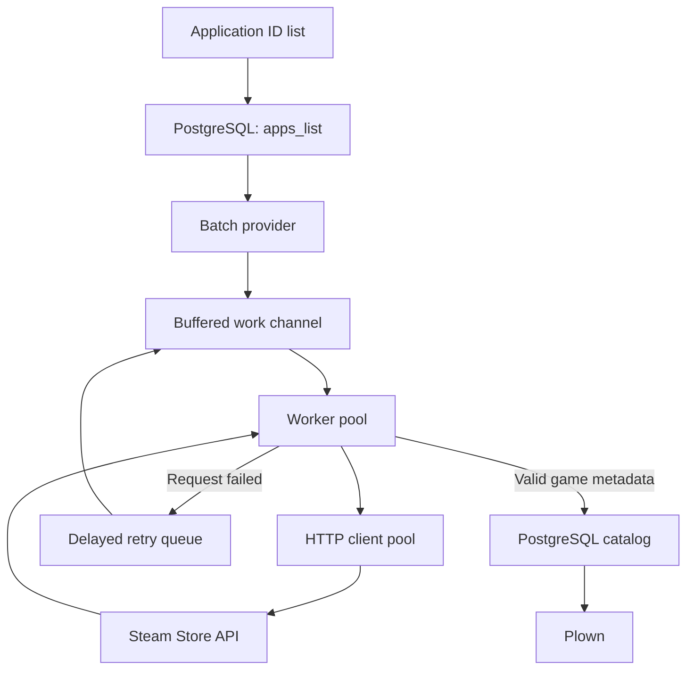

# Okop

A concurrent Steam catalog collector written in Go. Okop imports a list of Steam application IDs, fetches game metadata in batches, and stores it in PostgreSQL for use by [Plown](https://github.com/smakimka/plown), a collaborative game selection application.

## Features

- Batch requests for up to 50 application IDs, processed by a configurable pool of workers.
- HTTP client pool with request timeouts and configurable cooldowns.
- In-memory priority queue for delayed retries, using a min-heap and exponential backoff.
- Transactional upserts of game metadata, developers, publishers, and tags.
- Cached developer and publisher lookups.
- Live terminal progress display, structured logs, and per-client processing statistics.
- Separate commands for importing application IDs, updating tag names, and testing HTTP client connectivity.

## Architecture



The provider divides application IDs into batches of 50. The parser starts one worker per configured HTTP client. Failed requests return to the work channel after a delay rather than keeping a worker occupied. The retry delay starts at 5 seconds and grows to a maximum of 5 minutes, after which the backoff cycle resets.

Each successful game upsert runs in a database transaction. The schema includes normalized many-to-many relationships and a GIN-indexed array of tag IDs for catalog filtering.

## Getting started

### Prerequisites

- Go 1.24.2 or newer
- PostgreSQL (the included Compose configuration uses PostgreSQL 17)
- [goose](https://github.com/pressly/goose) for migrations
- [just](https://github.com/casey/just) (optional, for the supplied recipes)
- A local list of Steam application IDs and network access to the Steam API

Run the commands below from the repository root.

### 1. Start PostgreSQL and apply migrations

For local development, the included Compose file can start the database:

```sh
docker compose up -d postgres
just migrate
```

Wait for PostgreSQL to accept connections before running migrations. Use a new development database: some historical migrations replace existing catalog tables.

The Go commands and migration recipes use the following environment variables:

| Variable | Default |
| --- | --- |
| `POSTGRES_HOST` | `localhost` |
| `POSTGRES_PORT` | `5432` |
| `POSTGRES_DB` | `games_db` |
| `POSTGRES_USER` | `parser` |
| `POSTGRES_PASSWORD` | Local development default in the source |
| `POSTGRES_SSLMODE` | `disable` |

If using a separate database, set the connection variables before running the commands. Replace development credentials and configure secure database access for any non-local deployment.

### 2. Configure the HTTP client pool

Create a local `proxies.json` file. This minimal example uses a direct connection:

```json
{
  "proxies": [
    {
      "name": "direct",
      "url": ""
    }
  ],
  "timeouts": {
    "app_info": "15s"
  },
  "throttle_strategy": {
    "multi": 2,
    "min_wait": "2s",
    "max_wait": "30s"
  }
}
```

An empty URL means no proxy. Use only authorized network connections and respect the upstream API's usage limits. The duration values above are illustrative, not performance recommendations.

### 3. Import application IDs

Create `games_appid.json` containing an array of application records, for example:

```json
[
  {
    "appid": 730,
    "name": "Counter-Strike 2",
    "last_modified": 1700000000
  }
]
```

Here `last_modified` is a Unix timestamp; the example value is illustrative. The import command consumes an existing file rather than downloading the full list itself.

```sh
go run ./cmd/applist
```

### 4. Collect metadata and resolve tags

```sh
go run ./cmd/parser
go run ./cmd/tags
```

The tag command also attempts to resolve unnamed tag IDs discovered during collection. Run it again after later imports if needed.

Both local JSON input files are excluded by `.gitignore`. Do not commit credentials or database dumps.

## Commands

| Command | Purpose |
| --- | --- |
| `go run ./cmd/applist` | Import application IDs into PostgreSQL |
| `go run ./cmd/parser` | Collect game metadata |
| `go run ./cmd/tags` | Update and resolve tag names |
| `go run ./cmd/proxytest -config proxies.json` | Test configured HTTP clients and report request latency |
| `go test ./...` | Run the available Go tests |

Avoid sharing diagnostic output containing private connection details.

## Project layout

```text
cmd/                 Command entry points
internal/config/     Runtime configuration
internal/provider/   Batch production
internal/worker/     Concurrent processing
internal/retry_queue/ Delayed retry scheduling
internal/repo/       PostgreSQL persistence
internal/observer/   Processing statistics
internal/ui/         Terminal progress display
pkg/steam_proxy/     Steam API client
pkg/proxy_pool/      HTTP client pool
migrations/          Database schema migrations
```

## Project status

Personal project under active development. The catalog is limited to the supplied application IDs and the metadata available from Steam. The retry queue is in memory and does not impose a total attempt limit. The included parser Dockerfile currently targets Linux ARM64 and requires a local `proxies.json` at build time; the native Go commands are the simpler development option.

Okop is an independent project and is not affiliated with Valve or Steam.
